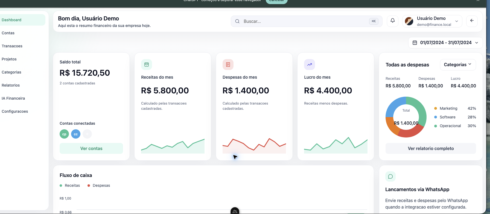

# Finance Dashboard

Dashboard financeiro full-stack com frontend em Nuxt 4, API em Fastify e integração preparada para Supabase.



## Visão geral

- Dashboard de saldo, receitas, despesas e lucro;
- contas, transações, projetos, categorias e relatórios;
- autenticação por cookies assinados;
- integração com Supabase para usuários e dados financeiros;
- modo demo local para apresentação e desenvolvimento;
- PM2 + Nginx para produção;
- deploy automático via GitHub Actions.

## Stack

| Camada | Tecnologia |
| --- | --- |
| Frontend | Nuxt 4, Vue 3, TypeScript |
| Backend | Fastify 5, TypeScript, Zod |
| Dados e autenticação | Supabase |
| Produção | Nginx, PM2, GitHub Actions |

## Rodando localmente

```bash
cd backend
pnpm install
pnpm dev
```

Em outro terminal:

```bash
cd frontend
pnpm install
pnpm dev
```

Acesse http://localhost:3000/auth/login.

O checkout já vem com um acesso demo local:

```text
E-mail: demo@finance.local
Senha: Finance@123
```

Esse acesso usa dados de demonstração e é controlado por `LOCAL_DEMO_AUTH=true` no ambiente de desenvolvimento. Em produção, use Supabase e defina `LOCAL_DEMO_AUTH=false`.

## Estrutura

```text
backend/                 API Fastify e schema Supabase
frontend/                Aplicação Nuxt
docs/screenshots/        Capturas das principais telas
docs/DEPLOY.md           Guia completo de publicação
ecosystem.config.cjs     Processos do PM2
.github/workflows/       Deploy automático
```

## Deploy

O passo a passo de produção está em [docs/DEPLOY.md](docs/DEPLOY.md). Ele cobre instalação da VPS, variáveis, build, Nginx, HTTPS, PM2 e deploy automático via SSH.

## Telas

| Tela | Captura |
| --- | --- |
| Dashboard | [01-dashboard.png](docs/screenshots/01-dashboard.png) |
| Contas | [02-contas.png](docs/screenshots/02-contas.png) |
| Transações | [03-transacoes.png](docs/screenshots/03-transacoes.png) |
| Projetos | [04-projetos.png](docs/screenshots/04-projetos.png) |
| Relatórios | [05-relatorios.png](docs/screenshots/05-relatorios.png) |
| Configurações | [06-configuracoes.png](docs/screenshots/06-configuracoes.png) |
